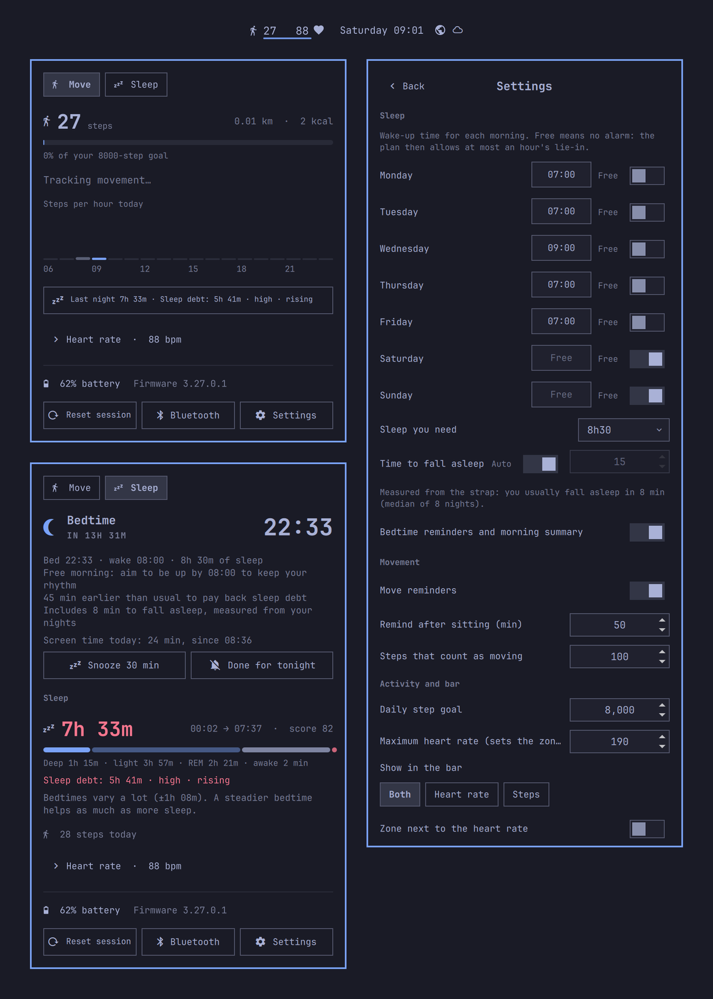

# Ebb

**Flow by day, ebb by night.** Ebb follows the tide of your day from an
**Amazfit Helio Strap**, in the Omarchy bar: steps and move reminders while you're
up, a sleep coach as the evening comes in, and last night's sleep, naps and sleep
debt. Heart rate also works with any Bluetooth LE heart rate strap.

Ebb was called Helio Strap until 1.3.0; see [Coming from Helio Strap](#coming-from-helio-strap).



The plugin follows your day:

- **During the day it's about movement.** The bar shows a walker and today's steps.
  The panel opens on **Move**: steps against your daily goal, steps per hour today
  (from the strap's own minute data), how long you've been sitting, and in the
  morning a one-line recap of the night.
- **Move reminders with proof:** while you're at the computer, after 50 minutes
  without a move (about 10 steps within 10 minutes) you get a nudge and the walker
  turns highlighted with "Move". Only walking clears it: the strap has to count the
  steps, live or later from its minute log (a walk out of Bluetooth range counts once
  it syncs). At most two nudges per sitting stretch, none in your last hour before bed.
- **From two hours before bedtime it becomes a sleep coach.** The panel opens on
  **Sleep**: bedtime and a countdown, what going to bed now gets you, the plan,
  last night, sleep debt and regularity. An hour before bedtime the bar shows a
  moon; past bedtime it turns red.
- **Move / Sleep tabs** at the top of the panel switch views any time; heart rate
  (zones, a ten-minute chart, session stats) sits collapsed at the bottom.
- **Right-click** resets the session.
- English and French.

## Install

```bash
omarchy plugin add https://github.com/lorismaz/omarchy-ebb --enable
```

The panel talks to the strap through a small Bluetooth helper, `ebb-strap`, written
in Rust (source in `helper/`). The first time you open the panel it offers
**Install helper**, which runs [`install-helper.sh`](install-helper.sh): it downloads
the helper for your machine (x86_64 or aarch64) from this repository's
[GitHub release](https://github.com/lorismaz/omarchy-ebb/releases), checks its
SHA-256 against the value pinned in the script, and installs it to
`~/.local/share/ebb/bin/`. The release binaries are built by
[GitHub Actions](.github/workflows/release.yml) from the tagged source.

A `ebb-strap` already on your `PATH` (for example one you built yourself) is used
instead. An AUR package is ready in `packaging/aur/` for when AUR registration reopens.

Then pair the strap in Omarchy's Bluetooth panel, open the panel and confirm it with
**This is mine**. Nothing is read from any strap until you do: on a shared computer, a
paired strap may be someone else's. Heart rate, zones and battery then work straight away.
To switch straps, use **Forget** under Settings → Strap.

## Steps (optional)

The strap only shares steps over Zepp's encrypted channel, which needs the strap's **auth key**.
Click **Set up steps** in the panel. A terminal window opens where you either:

- **log in with your Zepp account** (email + password), which fetches the key, or
- **paste a key** you already have, for example from Gadgetbridge.

The key is saved to your desktop keyring (Secret Service), never to a file, and the
password is never stored or logged. Steps appear within a few seconds.

Good to know:

- **Email + password accounts only.** If you sign in to Zepp with Google, Apple or a
  phone number, add a password to your account in the Zepp app first.
- **This uses Zepp's private API**, the way the Zepp app does. It may stop working if
  Zepp changes it; heart rate keeps working regardless.
- **Re-pairing the strap in the Zepp app changes its key.** The panel tells you when the
  saved key is rejected; run Set up steps again. A one-off refusal (the strap busy with
  the phone) clears by itself: the same key is tried again after two minutes.

## Sleep coach

With steps set up, the plugin also reads your sleep sessions from the strap (it
always answers "keep on device", so the Zepp app still syncs the same nights) and
keeps up to 30 nights locally in `~/.local/state/ebb/`. Nothing is
downloaded while the computer's clock is not set yet, and readings stamped more
than ten minutes ahead of it are dropped. When downloads fail twice in a row,
the helper reconnects: the strap's history service sometimes stalls on a link
that otherwise works.

- **Wake schedule:** one wake-up setting per weekday, each a time like `07:00` or
  `free`. Each evening plans for the next morning. A free morning aims for at most
  an hour's lie-in after your usual wake time (the median of your set days).
- **Bedtime** is planned as time in bed: wake − (sleep need + payback) − time to
  fall asleep − the time you typically lie awake at night (median of 14 nights,
  max 60 min).
- **Time to fall asleep** is measured from the strap's per-minute data: from each
  sleep onset it walks back through still minutes (worn, no steps, low movement) to
  when you lay down. Nights where the strap was put on just before sleep only give
  a minimum and are left out. With Auto on (the default) the plan uses the median
  of the last 14 nights once 5 are measured, and your manual value until then. With 2h or more of debt it moves earlier by debt ÷ 4 (max 60 min,
  in 15-min steps), never more than an hour before your usual bedtime.
- **Sleep debt** is a running balance in real hours, night by night:
  `D = max(0, 0.93·D + max(need − asleep, −2h))`, where asleep is the night plus
  the day's naps (the strap's own nap list; today's show under the night). Naps
  count for the debt only: bedtime, regularity and time to fall asleep follow
  nights. Nights without data only decay; it shows "calibrating" until 5 of the
  last 14 nights are recorded. Levels: on track < 2h, moderate 2–5h, high > 5h.
- **Regularity:** spread of bedtimes over 14 nights (flagged above ±60 min) and
  weekend shift of mid-sleep (flagged at 1h or more).
- **Notifications, only while you're at the computer:** wind-down an hour before
  bedtime, a bedtime notice, reminders at +30 and +90 min, then silence; urgent
  at most once a night (never before a free morning). A morning summary on your
  first activity after waking. Snooze and "Done for tonight" in the panel.

Why these rules: chronic short sleep builds a deficit people stop noticing
(Van Dongen 2003); one long night doesn't repay it and recovery takes days
(Banks 2010, Belenky 2003, Kitamura 2016), hence the 2h payback cap and slow
decay; regularity matters independently of duration (Phillips 2017, Windred 2024)
and weekend shifts ("social jetlag") are linked to worse health (Roenneberg 2012);
repeated reminders fade quickly (Giuntella, Saccardo & Sadoff 2025), hence the
short sequence. The level bands follow Oura and Rise, and the decay rate, payback
divisor and regularity thresholds are heuristics, not validated values. Sleep
stage minutes from consumer wearables are less reliable than total sleep, so the
coach only uses total sleep and sleep/wake times.

## Settings

Open the panel and click **Settings**, or use `omarchy bar set lorismaz.ebb <key> <value>`
(for example `wakeWed 09:00`). Settings:

Show in the bar · move reminders, minutes of sitting and steps that count as moving · wake-up time for each weekday · sleep you need · minutes
to fall asleep · bedtime reminders · daily step goal · maximum heart rate (sets
the zones) · strap name filter · reconnect automatically · zone next to the heart rate.

## Requirements

The `ebb-strap` helper (above), BlueZ, and a Secret Service keyring
(`secret-tool`, from libsecret) for steps.

## Privacy

Everything stays on your machine. The only network traffic is the optional Zepp login
in Set up steps, which talks to Zepp's servers over HTTPS, and downloading the helper
from GitHub when you click Install helper.

- Only the strap you confirmed is followed; other paired devices are listed by name
  and address for you to choose from, never connected to or read.
- Notifications go to the desktop over D-Bus through the helper, so their contents
  (sleep, bedtime, sitting time) never appear on a command line other accounts could see.
- Sleep history and daily activity live in `~/.local/state/ebb/`, which the
  plugin keeps private to your account (mode 0700), one sleep history per strap.
- The Zepp auth key is in your desktop keyring, never in a file.

## Tests

```bash
node tests/model.test.js
cargo test --manifest-path helper/Cargo.toml
```

To try a local build of the helper before the package is installed:

```bash
cargo build --release --manifest-path helper/Cargo.toml
ln -s "$PWD/helper/target/release/ebb-strap" ~/.local/bin/ebb-strap
```

## Credits

The helper is written from the protocol notes in [PROTOCOL.md](PROTOCOL.md): byte
layouts and message sequences only, no code from other projects. Those facts come
from public reverse-engineering of Zepp OS devices, notably by the
[Gadgetbridge](https://codeberg.org/Freeyourgadget/Gadgetbridge) project, and the
Zepp login follows [huami-token](https://codeberg.org/argrento/huami-token) (MIT).

Not affiliated with or endorsed by Amazfit, Zepp Health or Huami. Amazfit, Helio
and Zepp are trademarks of their owners; Ebb names the Helio Strap only to say
which device it works with.

## Coming from Helio Strap

Ebb is the same plugin under a new name: a new plugin id (`lorismaz.ebb`) and
helper (`ebb-strap`). Remove the old one and add Ebb:

```bash
omarchy plugin remove lorismaz.helio-strap
omarchy plugin add https://github.com/lorismaz/omarchy-ebb --enable
```

Your strap's key, sleep history and screen time carry over on their own (the key is
still read from where Helio Strap saved it, and `~/.local/state/helio-strap/` moves
to `~/.local/state/ebb/` the first time Ebb starts). Settings set from the panel
(wake times, sleep need, your confirmed strap) need setting again.

## Commands

```bash
omarchy-shell lorismaz.ebb toggle          # open or close the panel
omarchy-shell lorismaz.ebb openSettings    # open the settings page
omarchy-shell lorismaz.ebb showView move    # open on the Move or Sleep view
omarchy-shell lorismaz.ebb setupSteps      # save the strap's auth key
omarchy-shell lorismaz.ebb snooze          # snooze bedtime reminders 30 min
omarchy-shell lorismaz.ebb doneForTonight  # mute reminders until morning
```

## Remove

```bash
omarchy plugin remove lorismaz.ebb
rm -rf ~/.local/share/ebb                          # the Bluetooth helper
secret-tool clear service omarchy-ebb              # forget the saved auth key
rm -rf ~/.local/state/ebb                          # forget sleep history and screen time
```
